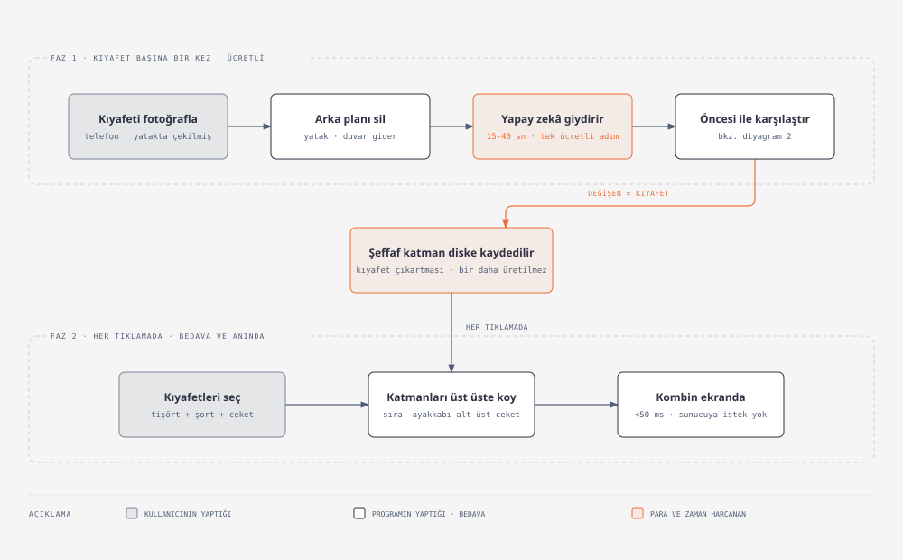
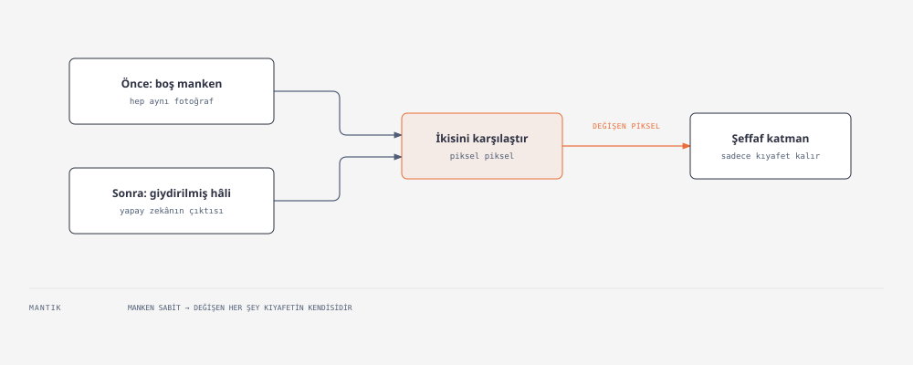

# 👕 AI Sanal Dolap

Kullanıcı kendi kıyafetlerini fotoğraflayıp dijital dolabına ekliyor; sonra bu
kıyafetleri bir manken üzerinde **anında giydirip** kombin deniyor, beğendiğini
tek tıkla **gerçekçi render**'a çeviriyor ve doğal dille düzenliyor
("kolları kıvır", "sola dön").



**Durum:** Faz 0 ✅ · Faz 1 ✅ · Faz 2 ✅ · Faz 4 ✅ · Faz 6 ✅ · Faz 3 ve 5 açık
· **444 test geçiyor** (hiçbiri gerçek API çağırmıyor)

Bu README mimariyi ve gerekçelerini anlatıyor. Her kararın arkasındaki **ölçüm
kayıtları** — çürüyen hipotezler dâhil — [`HANDOFF.md`](HANDOFF.md) içinde
(3.700+ satır mühendislik günlüğü). Teknik bilgisi olmayan biri için hazırlanmış
görsel anlatım: [`nasil-calisiyor.html`](nasil-calisiyor.html).

---

## Hızlı başlangıç

```bash
pip install -r requirements.txt
pip install "rembg[cpu]"      # sade `pip install rembg` motoru KURMUYOR
```

`.env.example`'ı `.env` olarak kopyalayıp anahtarları gir, sonra doğrula:

```bash
python cli.py doctor
```

`doctor` anahtarları **maskeli** gösterir (kopyalanamaz), eksikleri ve
opsiyonelleri ayırır. Anahtar yoksa hat çökmez: öznitelik çıkarımı mock'a,
VTON sağlayıcısı `mock`'a düşer — tüm hat anahtarsız da uçtan uca çalışır.

Arayüzü başlat:

```bash
python cli.py web
```

→ http://127.0.0.1:8000 · Telefondan erişmek için `--host 0.0.0.0`.
Windows'ta `Dolabi Ac.bat` çift tıklamak da aynı işi yapıyor.

### Microsoft Foundry ile çalıştırma

FASHN / fal / Anthropic anahtarları yerine tek bir **Microsoft Foundry**
kaynağı kullanılabilir. Tek anahtar hem kıyafet okumaya (Claude ya da görsel
destekli bir sohbet modeli) hem bir görüntü modeline (sanal deneme, manken
üretimi, düzenleme sohbeti) erişiyor.

1. Foundry'de bir kaynak oluştur ve dağıtımları aç: bir **görüntü modeli** —
   Microsoft'un kendi **MAI** modelleri (örn. `MAI-Image-2.6`) ya da
   **gpt-image** (örn. `gpt-image-2`) — ve kıyafet okuma için bir **Claude**
   modeli (örn. `claude-opus-5-5`) ya da Claude'a kota çıkmıyorsa görsel
   destekli herhangi bir **sohbet modeli** (örn. `gpt-4.1-mini`).
2. `.env`'e ekle:

   ```
   FOUNDRY_RESOURCE=kaynak-adin
   FOUNDRY_API_KEY=...
   FOUNDRY_IMAGE_DEPLOYMENT=MAI-Image-2.6
   FOUNDRY_VISION_DEPLOYMENT=gpt-4.1-mini
   # FOUNDRY_CLAUDE_DEPLOYMENT=claude-opus-5-5   # Claude'a kota varsa; tanımlıysa önce o kullanılır
   ```

3. `python cli.py doctor` ile "Microsoft Foundry" bölümünü kontrol et.
4. `Dolabi Ac.bat` (ya da `python cli.py web`) → http://127.0.0.1:8000.
   Veritabanı ilk açılışta kendiliğinden kuruluyor.
5. Önce **+ Yeni manken** ile tam boy bir fotoğraf yükle (önden, düz duruş,
   dar ve sade kıyafet), sonra **+ Kıyafet ekle** ile kıyafetleri ekle. Yeşil
   çıkarım base'i kendiliğinden kuruluyor (bkz. `HANDOFF.md` §53). Sıra önemli:
   manken fotoğrafı yokken kıyafet eklenirse görüntü modeli önce kendi
   mankenini üretiyor (1 ücretli çağrı). Komut satırından da olur:
   `python cli.py mannequin --from-photo manken.jpg`.

**Kod değişikliği gerekmiyor:** MAI ayrı bir API kullanıyor ama dağıtım adı
`MAI-Image` ile başladığı sürece kendiliğinden seçiliyor (başka ad verdiysen
`FOUNDRY_IMAGE_API=mai`). MAI yolu `openai` paketine de ihtiyaç duymuyor.

Parçalar bağımsız: yalnızca Claude dağıtımını tanımlarsan öznitelik çıkarımı
Foundry'den gelir, sanal deneme diğer sağlayıcılarda kalır. FASHN anahtarı da
tanımlıysa, mankene sağlayıcı bağlanmadıkça sanal denemede ve düzenlemede
FASHN önceliklidir.

**Maliyet:** ücretli her düğmenin yanında hangi modelin çağrılacağı ve tahmini
ücret yazıyor. MAI-Image-2.6 çağrı başına ~$0.06 (yukarı yuvarlanmış tahmin),
FASHN tryon-max $0.15, kıyafet okuma (gpt-4.1-mini) ~$0.001. Kesin rakam Azure
Cost Management'ta (bkz. `HANDOFF.md` §54).

> ⚠️ **Foundry'de hazır bir sanal deneme modeli yok.** MAI ve gpt-image genel
> amaçlı modeller; katman mimarisinin istediği "kıyafet dışı sabit kalsın"
> şartını kendiliğinden sağlamıyorlar. Bunun bir kısmını kod sağlıyor: model
> çıktısı, kıyafetin olabileceği bölgenin (kategori bandı ∩ kişi silüeti)
> dışında base fotoğrafla değiştiriliyor. Bölgenin **içinde** ise model gövdeyi
> kaydırır ya da rengi değiştirirse katman kirlenir. **MAI-Image-2.6 gerçek
> çağrılarla 12 kıyafette ölçüldü** ve uygulamada FASHN düzeyinde çıktı; yeşil
> çıkarım base'iyle renkte hafif kayma kalıyor (bkz. `HANDOFF.md` §51.6–§51.9).
> **gpt-image yolu henüz ölçülmedi.** Kişi silüeti için `rembg` kurulu olmalı —
> yoksa yalnızca dikey bant korunuyor.

### Komutlar

| Komut | Ne yapar |
|---|---|
| `python cli.py doctor` | Kurulum + anahtar kontrolü (maskeli) |
| `python cli.py init` | Veritabanını kurar |
| `python cli.py add <foto>` | Kıyafet ekler |
| `python cli.py add-folder <klasör>` | Toplu ekler |
| `python cli.py list` · `show <id>` · `rm <id>` · `stats` | Dolap yönetimi |
| `python cli.py mannequin --list` | Mankenleri listeler (▶ = aktif) |
| `python cli.py mannequin --from-photo X --name "Yaz"` | **Yeni** manken ekler (bedava) |
| `python cli.py mannequin --use <id>` | Aktif mankeni değiştirir (bedava, hiçbir şey silmez) |
| `python cli.py mannequin --rm <id>` | Mankeni + katmanlarını siler (**geri alınamaz**) |
| `python cli.py build-layers [--id N] [--seed 42]` | Katman üretir (**ücretli**) |
| `python cli.py build-layers --reextract` | Saklanmış ham çıktıdan yeniden çıkarır (**bedava**) |
| `python cli.py preview 8 6 -o kombin.png` | Katmanları birleştirir |
| `python cli.py render 10 7` | Kombini zincirleme giydirir (**ücretli**, önbellekli) |
| `python cli.py tryon-ab <id> --seed 42` | VTON ayar karşılaştırması (**ücretli**) |
| `python cli.py layer-ab <id>` | Katman mimarisi model karşılaştırması (**ücretli**) |
| `python cli.py web` | Giydirme arayüzünü başlatır |
| `pytest` | 444 test |

> `--reextract` önemli: çıkarım parametrelerini ayarlarken API'ye tekrar ödeme
> yapmamak için ham VTON çıktıları diskte saklanıyor. Bu projedeki iyileştirmelerin
> çoğu bu sayede **sıfır maliyetle** ölçüldü.

---

## Mimari kararlar

### 1. Her kombinde VTON çalıştırılamaz — katman bir kez üretilir

Kullanıcı manuel deneme yaparken 20-30 kombin dener. Her seçimde difüzyon modeli
çalıştırmak **her tıklamada 15-40 saniye + her tıklamada para** demek. Kullanılamaz.

```
YÜKLEME ANINDA (kıyafet başına 1 kez):
  fotoğraf → arka plan temizle → VTON(base_manken, kıyafet)
           → base'den FARKI al → temizle → şeffaf PNG katmanı

GİYDİRME ANINDA (her tıklamada):
  katmanları z-sırasına göre bindir → anında (<50 ms), bedava
```

Bütün katmanlar **aynı manken, aynı poz, aynı çözünürlük** üzerinden üretildiği
için piksel piksel hizalı; bindirme birebir tutuyor. Maliyet tek seferlik ve
kıyafet sayısıyla doğrusal — sonra sınırsız kombin.

### 2. Kategori tablosu = katman sırası + çakışma kuralı

`config.CATEGORIES` sadece bir etiket listesi değil, iki kuralı taşıyor:

| Kategori | `z` (çizim sırası) | `slots` (kapladığı bölge) |
|---|---|---|
| Ayakkabı | 10 | `ayak` |
| Alt giyim | 20 | `alt` |
| Elbise | 25 | `ust`, `alt` |
| Üst giyim | 30 | `ust` |
| Dış giyim | 40 | `dis` |
| Aksesuar | 50 | `aksesuar` |

`z` çizim sırasını, `slots` "hangi ikisi aynı anda giyilemez"i belirliyor.
Elbise hem `ust` hem `alt` kapladığı için tişört seçilince otomatik düşüyor.

Kural **istemcide tanımlanmıyor** — arayüz bu tabloyu sunucudan çekiyor, yani
tek kaynak `config.py`.

### 3. Katmanı segmentasyonla değil, **farkla** çıkarıyoruz

Manken sabit olduğuna göre, giydirme sonrasında **değişen pikseller kıyafetin ta
kendisidir.** Ayrı bir segmentasyon modeli gerekmiyor:



Ham fark yetmiyor. Dokuz temizlik adımının **her biri** bir kusur ölçüldükten
sonra eklendi:

| Adım | Neden gerekli |
|---|---|
| Açma (aşındır→genişlet, **eşit çekirdek**) | Difüzyon mankenin geri kalanını da milimetrik oynatıyor → serpinti. Çekirdekler eşit olmazsa siluet sessizce şişer |
| Kapama (genişlet→aşındır, **eşit çekirdek**) | Kıyafet rengi tene yakınsa fark zayıf → katmanda delik |
| 1 px genişletme | Fark eşiği kıyafetin yumuşak kenarında aşılamıyor; genişletmezsek kenardan base sızıyor |
| En büyük bağlı bileşen | VTON tüm görüntüyü yeniden üretiyor; bir tişört katmanının **%5'i bacaktaydı** |
| Delik doldurma (+ alfayı da opak yap) | Silüet içindeki her boşluk tanım gereği hata. Alfa güncellenmezse delik dolar ama saydam kalır |
| Bölge kapısı | Pantolon katmanı yüz bölgesine "hayalet yüz" çiziyordu — konuma bakan kategori kapısı |
| Base sızıntısını sil (Lab uzayında) | Base'in kıyafeti komşu bölgede yeniden çizilip katmana giriyor |
| Kontur pürüzsüzleştirme | Silmenin bıraktığı 1-2 px çentikler; kapatılmazsa siluet boyunca zemin sızar |
| Kenar yumuşatma + kenar rengi tazeleme | Alfa 0→255 sıçrarsa merdiven basamağı; en dış piksel sırası kıyafetle arkasının karışımı → bindirmede renkli halka |

> ⚠️ **`int32` kullanmak zorunlu.** `int16`'da `255² = 65025` taşıyor (tavan
> 32767), fark negatife dönüp `sqrt` NaN üretiyor, `NaN > eşik` her zaman
> `False` — katman **sessizce boşalıyor.** Üstelik bu tam olarak ayırt edilmesi
> en kolay durumda oluyor (beyaz mankene siyah pantolon). Regresyon testi:
> `test_layers.py::test_yuksek_kontrast_katmani_yakalar`.

### 4. Üç base — mimarinin en önemli kararı

Fark tabanlı çıkarımın doğal kısıtı şu: **mankenin kıyafetiyle aynı renkteki
kıyafetler çıkarılamaz**, çünkü fark sıfıra yakın kalıyor. Buna "kör nokta"
diyoruz ve uzun süre mimarinin kabul edilmiş bedeliydi.

Çözüm, kullanıcının hiç görmediği bir ayrımdan çıktı: **çıkarım base'inin
gerçekçi görünmesi gerekmiyor.** O hâlde mankenin kıyafeti yazılımla, dolaptaki
her şeyden maksimum uzak bir renge (chroma yeşil) boyanabilir — geometri birebir
aynı kalır, boyama ücretsizdir.

| dosya | rengi | kim kullanıyor | kullanıcı görür mü |
|---|---|---|---|
| `base_{id}.png` | gerçek fotoğraf | gerçekçi render zinciri · gösterim kaynağı | evet |
| `base_{id}_extract.png` | **chroma yeşil** | **VTON + fark çıkarımı** | **hayır** |
| `base_{id}_display.png` | nötr koyu | 2+ kıyafetli bindirmenin zemini | evet |

**Ölçülen sonuç** (en kötü vaka: mankenin kıyafetiyle neredeyse aynı renkte
lacivert tişört, renk uzaklığı 1.0):

| çıkarım base'i | kaplama | base sızıntısı |
|---|---|---|
| orijinal (lacivert) | %5.71 | **%44.8** |
| **chroma yeşil** | %8.71 | **%0.1** |

Kör nokta kapandı: kullanıcı ne giyerse giysin katman temiz çıkıyor, yeniden
çekim gerekmiyor. Yeşilin bindirmede görünmesi de zorunlu değil — rengi biz
seçtiğimiz için temizlenmesi en kolay renk (`drop_extract_color`, kalibre
edilmiş tolerans; gerçekten neon yeşil bir kıyafet kendini koruyor).

Sahnede ne gösterildiği seçime bağlı:

| seçim | görüntü |
|---|---|
| boş | gerçek fotoğraf |
| 1 kıyafet | **ham VTON çıktısı** — ücreti zaten ödenmiş, çıkarım kusuru yok · yeşil bölgeler gerçek fotoğrafla doldurulur |
| 2+ kıyafet, hepsi uzak renkte | nötr zemin + katmanlar |
| 2+ kıyafet, biri kör noktada | gerçek fotoğraf zemin + katmanlar |

### 5. Arka plan temizleme hattın tavanını belirliyor

VTON modelleri düz zeminde, serilmiş **katalog görselleriyle** eğitildi.
Kullanıcının yatağın üstünde çektiği buruşuk tişört kötü sonuç veriyor.

| Yöntem | Ne zaman | Kalite |
|---|---|---|
| `rembg` | Kuruluysa (~170 MB model) | İyi |
| `flood` | rembg yoksa — saf numpy/PIL yedeği | Düz zeminde makul |

`flood` yedeğinin kritik ayrıntısı: bir pikselin arka plan sayılması için arka
plan rengine yakın olması **yetmiyor**, ayrıca **kenara bağlı** olması gerekiyor
— yoksa beyaz tişörtün üstündeki beyaz baskı da silinip kıyafette delik açılıyor.

Yükleme hattının sırası da ölçümle değişti: önce **kırp**, sonra **hizala**.
Ters sırada, hizalama için %53'e küçültülen görselde segmentasyon bozuluyor ve
kıyafet kırpılıyordu — iki ayrı koruma da bunu kaçırmıştı.

### 6. Öznitelik çıkarımı: yapılandırılmış çıktı, serbest metin değil

`wardrobe/vision.py` Claude'a JSON şeması dayatıyor (`output_config.format`) —
model şemaya uyan JSON üretmek zorunda, regex ayrıştırma yok. Çıkarılan alanlar:

`category` · `subcategory` · `color_name` · `color_hex` · `secondary_color_hex` ·
`pattern` · `style` · `seasons` · `fabric` · **`warmth` (0-10)** ·
**`formality` (0-10)** · `notes`

Son iki alan sadece etiket değil, **Faz 3'ün kural filtresinin girdisi**:
"18 derece" → warmth aralığı, "mülakat" → formality aralığı.

Üç ayrıntı: görsel 1024 px'e küçültülüyor (token maliyetini birkaç kat
düşürüyor, doğruluğu düşürmüyor) · EXIF döndürme elle uygulanıyor (telefon
fotoğrafında piksel verisi yan, sadece etiket "dik" diyor) · VLM'e **kırpılmış**
görsel gidiyor, orijinal değil.

### 7. Sağlayıcı değiştirilebilir — A/B kod değişikliği değil

`wardrobe/vton.py` tek arayüz sunuyor: `try_on(model, garment, category)`.
Arkasında dört adaptör var:

| Sağlayıcı | Ne |
|---|---|
| `fashn` | FASHN doğrudan API, `tryon-max` — **varsayılan** |
| `fal` | fal.ai üzerinden FASHN v1.6 |
| `gemini` | görsel düzenleme (Faz 6 sohbeti) |
| `foundry` | Microsoft Foundry'deki MAI ya da gpt-image modeli — bölge kısıtlamasıyla (MAI ölçüldü, gpt-image ölçülmedi) |
| `mock` | bedava, sahte katman — testler ve kuru çalıştırma |

```bash
python cli.py build-layers --provider mock    # bedava
python cli.py build-layers --provider fashn   # gerçek, tryon-max
```

Model karşılaştırması bu yüzden tek bayrak: `layer-ab` ve `tryon-ab` komutları
soruyu sayıya çeviriyor.

**Bilinen sınır:** FASHN'ın kategori listesinde **ayakkabı ve aksesuar yok.**
Zorlamak bozuk katman üretiyor, o yüzden bu kategoriler `status="unsupported"`
işaretlenip atlanıyor — sessizce başarısız olmuyor.

### 8. Çoklu manken

`layers` tablosunun birincil anahtarı `(garment_id, mannequin_id)`, yani şema
baştan çoklu mankene hazırdı. Manken eklemek ve aktif mankeni değiştirmek
**ücretsiz** ve hiçbir şeyi silmiyor; sadece yeni mankende katman üretmek
ücretli. Manken silmek katmanlarını da siliyor ve geri alınamıyor — CLI onay
soruyor, testlerin ağırlığı veri kaybı senaryolarında.

---

## Ölçülmüş sonuçlar ve yöntem

Bu projenin ayırt edici tarafı özellik listesi değil, **karar verme biçimi.**
`HANDOFF.md` ölçümlerin tamamını, çürüyen hipotezler dâhil, tarihçesiyle taşıyor.

Üç kural işin içinden çıktı:

> **Hem sayı hem gözle ölç.** Görsel doğrulama metrik doğrulamanın yerine geçmez
> ama onun **veto hakkı** vardır.

> **Etkisiz bir filtre, olmayan bir filtreden tehlikelidir** — sorun çözülmüş
> sanılır. Filtre eklerken tetiklendiğini de ölç.

> **Bir ölçümün geçerliliği, ölçüldüğü koşulların hâlâ geçerli olmasına bağlı.**
> Sağlayıcı, model ya da base değişince eski ölçüm yeniden yapılmalı.

Üçüncüsü somut bir örnekte karşılığını buldu: base'i farklı renge boyama fikri
bir kez denenip **ölçümle elenmişti** ("çıkarımı düzeltir, bindirmeyi bozar").
O ölçüm doğruydu — ama koşulları sonradan iki kez değişti (gösterim base'i
ayrıldı, Lab sızıntı filtresi eklendi). Aynı fikir bugün çalışıyor ve projenin
en büyük kısıtını kaldırdı.

Ölçümde **çürüyen** hipotezlerden birkaçı, dürüstlük adına kayıtta:
renk filtresiyle katman temizleme · "zor kıyafeti otomatik tespit et" ·
şablon önselinin kurtarıcı olduğu varsayımı · slota özel yeşil varyantlar ·
kişi maskesinin krom maskesine katkısı. Beşi de mantıklı görünüyordu, beşi de
sayıda kaybetti.

---

## Veri modeli

```
garments   ─┬─ kıyafetler + öznitelikler + dosya yolları + hizalama
            │
mannequins ─┼─ mankenler (is_active ile aktif seçimi)
            │
layers     ─┤  (kıyafet × manken) → şeffaf PNG + z_index + status
            │   status: pending | ready | failed | unsupported | stale
outfits    ─┤  kaydedilmiş kombinler (manual | ai)
outfit_items┘  kombin ↔ kıyafet
```

Sonradan eklenen sütunlar `db.MIGRATIONS`'ta ve `_apply_migrations` idempotent.
Kural: bu listeye yalnızca **DEFAULT'u olan** sütunlar girer — DEFAULT'u anlamlı
olmayan bir sütun eklendiyse migration'ın onu düzelten bir adımı da olmalı.

Dosyalar UUID ile saklanıyor (`beyaz_gomlek.jpg` → `data/raw/a3f9c2d81e40.jpg`),
aynı adlı iki fotoğraf çakışmıyor; orijinal ad yedek çıkarım yolunda kategori
tahmini için `name_hint` olarak taşınıyor.

---

## Proje yapısı

```
config.py              yollar, kategori/katman tablosu, VLM ayarları
db.py                  SQLite şema + CRUD + idempotent migration
cli.py                 komut dağıtıcı
wardrobe/
  imageutil.py         EXIF, küçültme, rgb_distance(), to_lab(), apply_align()
  secrets.py           anahtar okuma + maskeli raporlama
  cutout.py            arka plan temizleme (rembg | flood) + person_mask
  vision.py            Claude vision + JSON şema + translate_prompt()
  ingest.py            yükleme hattı — tek giriş: add_garment()
  mannequin.py         mankenler + gösterim/çıkarım base'leri
  templates.py         22 çekim şablonu
  vton.py              sağlayıcılar: fashn | fal | gemini | mock
  layers.py            fark tabanlı katman çıkarımı + bölge kapısı + birleştirme
  render.py            zincirleme gerçekçi render + önbellek
  edits.py             düzenleme sohbeti + sürüm geçmişi
web/
  app.py               FastAPI uç noktaları
  static/              index.html · app.js · style.css
tests/                 444 test (21 dosya), API anahtarı gerektirmez
data/                  raw/ cutout/ layers/ mannequins/ renders/ + wardrobe.db
```

---

## Testler

```bash
pytest
```

444 test, ~90 saniye, **hiçbiri gerçek API çağırmıyor.** `conftest.py` her testte
API anahtarlarını siliyor, varsayılan veritabanını ve veri dizinlerini
`tmp_path`'e yönlendiriyor. Geliştiricinin `.env`'i yüklü olsa bile testler
**fatura üretmiyor** ve gerçek dolabı kirletmiyor.

Testlerin ağırlığı iki yerde: **veri kaybı** senaryoları (manken silme, katman
geçersizleme) ve **regresyon** — ölçümle bulunmuş her kusurun bir testi var.

---

## Bilinen sınırlar

Dürüstlük gereği, çözülmemişler:

- **Ayakkabı ve aksesuar için VTON yok** — sağlayıcının kategori listesinde
  yoklar. `unsupported` işaretlenip atlanıyor.
- **Gömlek içeride mi dışarıda mı** — katman sisteminde çözülemez, kabul edilen sınır.
- **Flat-lay fotoğrafta kollar kıvrıksa** model onu "kolun şekli bu" sanıyor;
  kolları yanlara açık serip çekmek gerekiyor.
- **Base sızıntısının mekanizması duruyor** — büyük ölçüde çözüldü ama model
  komşu bölgeyi yeniden çizmeye devam ediyor; görünmez hâle geldi, yok olmadı.
- **Saflık metriği açık nötr renklerde kör** — krem/beyaz/gri kıyafetlerde duvarı
  ve teni de kıyafet sayabiliyor. Doygun renklerde güvenilir, nötrlerde göze bak.
- **Base diz altından kesik** — ayakkabı ve tam boy oran için yeniden çekim gerekir.
- Kötü aydınlatma → renk kaybı → yanlış öznitelik.

---

## Yol haritası

| Faz | İçerik | Durum |
|---|---|---|
| **0** | Dolap altyapısı: yükleme, kırpma, öznitelik, DB, CLI | ✅ |
| **1** | Base manken + VTON + fark tabanlı katman çıkarımı | ✅ |
| **2** | Manuel giydirme arayüzü (FastAPI + CSS z-index) | ✅ |
| **3** | AI kombin önerisi: kural filtresi → renk uyumu → LLM | ⬜ Dolap büyüyünce |
| **4** | "Gerçekçi göster": tam VTON zinciri + önbellek | ✅ |
| **5** | Kişiselleştirilmiş manken (SMPL-X veya ölçüden figür) | ⬜ |
| **6** | Düzenleme sohbeti + sürüm geçmişi | ✅ |

**Faz 3 notu:** LLM'e 100 kıyafet atıp "seç" deme. Üç katman: (1) kural filtresi
— sıcaklık → `warmth`, bağlam → `formality`; (2) Lab uzayında renk uyumu → 8-10
aday; (3) LLM seçer + Türkçe gerekçe yazar.

**Faz 5 notu:** üç seviye var — (A) ölçüden figür, (B) SMPL-X, (C) tam 3B kumaş
simülasyonu. C aylar alır ve VTON'dan **kötü** sonuç verir; yapılmamalı. A/B'de
asıl iş SMPL-X değil, gri mesh'i fotogerçek hâle getirme adımı — VTON modelleri
insan fotoğrafı bekliyor.
